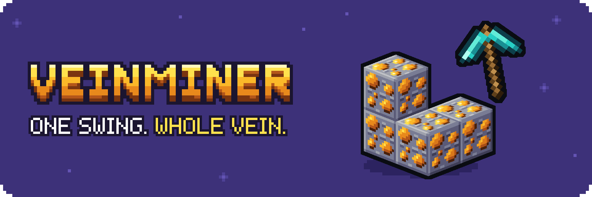

**Sneak, mine one ore, and the whole vein pops out in a chain, with any ore from any mod.**

Veinminer is a mod for **Minecraft Java 26.3, 26.2, 1.21.1 and 1.20.1** on **Fabric, Quilt, NeoForge and Forge**. Put it on the server and everyone who joins sees the chain, even with an unmodified game. In your own game it also adds a settings screen.

**New in 2.1:** a settings screen, so you never have to edit a file; dirt, sand, gravel and clay with any shovel; and your own list of blocks that vein too.

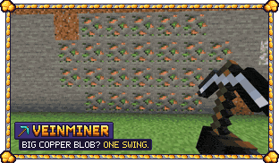
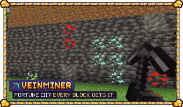

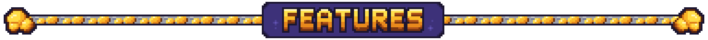

- **A chain, not a blink.** The vein pops block by block from the ore you mined, faster and faster. Each block squashes and snaps, and its loot flies in an arc to land at your feet.
- **Any ore, no list.** An ore from a mod that tags `#c:ores/<name>` is a vein of that name, and an ore tagged only `#c:ores` gets a vein of its own. Tin next to zinc stays two veins.
- **Dirt, sand, gravel and clay.** Sneak and dig with any shovel, modded ones too, and the whole patch comes out in the same chain. Sand and gravel wait for their turn instead of falling away. These four start off: switch them on in the settings screen.
- **Your own blocks.** Add any block, or a whole tag such as `#minecraft:logs`, and it veins too. Search every installed block in the settings screen, or add the block you're looking at.
- **Same loot as by hand.** Each block breaks as if you had mined it: its own drops, Fortune, Silk Touch, XP and tool wear. A vein never breaks your pickaxe.
- **Safe for servers.** Land claims and other protections are asked about every block, and a vein across a claim border breaks only the allowed part. A crash or a stopped server mid-chain leaves the rest of the vein as ore. Machines and fake players never start a vein.
- **Cheap.** Starting a vein of 64 takes under a millisecond on the server, and a whole chain costs about 14 ms of server time.
- **Everyone chooses.** Any player can turn it off or on for themselves with `/veinminer`.

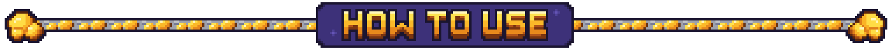

1. Hold a pickaxe (or a shovel for dirt, sand, gravel and clay, once they're on).
2. Sneak and mine an ore.

Creative mode never starts a vein, so building stays instant. When the vein is done, the action bar says how many blocks came out, or that your tool is too worn to go on.

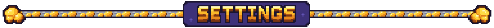

**In game:** on Fabric, open Mod Menu and press Veinminer's configure button (Mod Menu is optional); on NeoForge and Forge, press Config in the mod list. Every setting is a button, and changes apply right away in your world and on a LAN world you host. "Add or remove blocks..." opens the block picker: search every installed block, modded ones included, or add the block you're looking at.

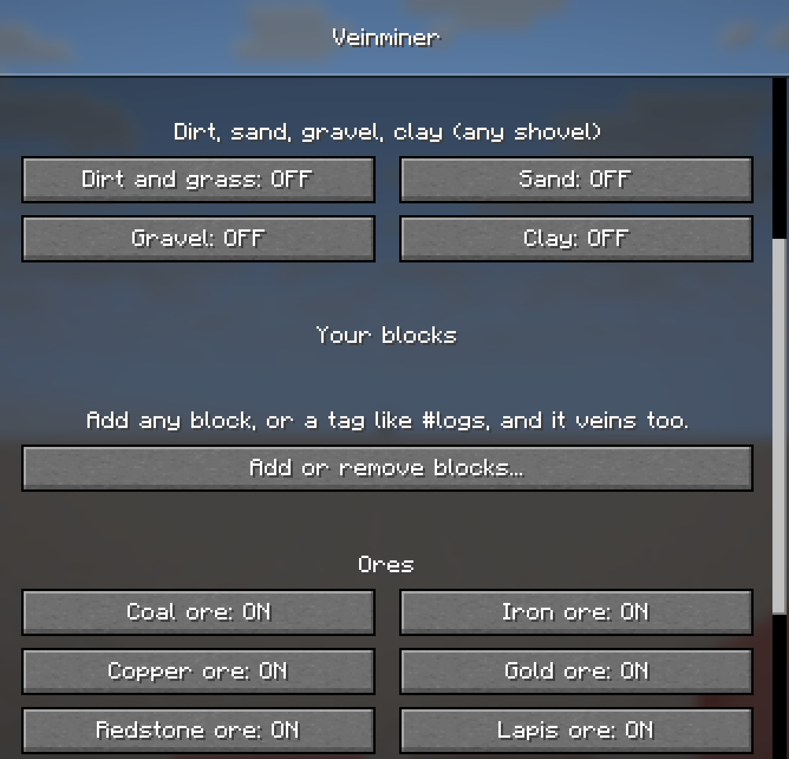
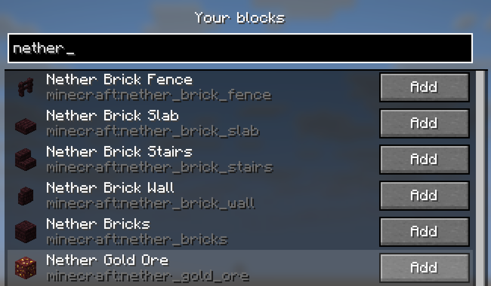

**On a server:** settings live in `config/veinminer.json`, re-read while the game runs. You can set the biggest vein (`max_blocks`, 64 by default), whether sneaking is needed, where the loot lands, durability use, diagonal veins, the animation (off breaks the whole vein at once), the action-bar message, a switch per group and your own block list. Operators can use `/veinminer status`, `/veinminer set <key> <value>`, `/veinminer add <block or #tag>`, `/veinminer remove <entry>` and `/veinminer reload`.

Modpack makers can add or move groups with a data pack: `data/<namespace>/veinminer/group/<name>.json` with `{"blocks": "#<namespace>:<tag>"}` (optional `"tool": "correct"` for any right tool, `"default": false` to start off), and `#veinminer:never` takes blocks out of every group. Blocks with a block entity are never mined by a vein, not even from your own list.

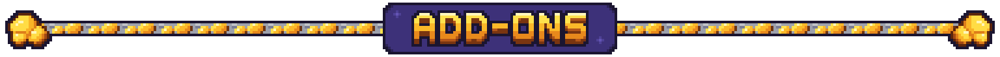

**[Enchanted Veinminer](https://www.curseforge.com/minecraft/mc-mods/enchanted-veinminer)** turns veinmining into a pickaxe enchantment you have to find first. It uses the data pack hooks that 2.0 keeps (`#veinminer:api/cancel`, `#veinminer:api/loaded`); they are tested here with a stand-in add-on, and the real add-on is not yet re-tested on 2.0. Making your own add-on? See the [add-on API](https://github.com/ProfetGit/veinminer/blob/main/docs/api.md). Mods get a Java hook, `VeinminerEvents.BEFORE_VEIN`.

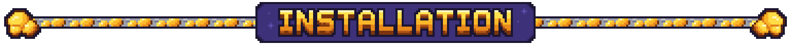

Put the jar in the `mods` folder of the server (or your singleplayer game). Fabric and Quilt use the `-fabric.jar` and need Fabric API (Mod Menu for the settings screen is optional); Forge and NeoForge use the `-forge.jar`. On 1.20.1 one jar serves Forge and NeoForge. Players who join a server don't need it.

**Coming from 1.3.x?** Remove the old data pack or jar first and don't run both. The first time a 1.3.x world loads, Veinminer imports your settings and each player's on/off choice, turns the old data pack off and tells the operators once.

**Conflicts.** FTB Ultimine, Liteminer, OreVein and Ore Excavation also mine veins. If one is installed, Veinminer warns the operators and the log. Use only one of them.

**Tested.** Every version on every loader boots and passes the self-test; an ore mod (Immersive Ores) was tried on 1.20.1 Fabric and Quilt. Not yet tested: the function-tag hooks and the 1.3.x migration on 1.21.1 and 1.20.1 (on 1.20.1 the `#veinminer:api/cancel` function tag cannot veto, the Java hook can), real land-claim mods, and a mod with `#c:ores/<name>` subtags. New in 2.1 and not yet tested: "Add the block I'm looking at" and adding a `#tag` through the block picker, the Mod Menu and Config buttons pressed by hand anywhere but Fabric 26.3, and your own blocks in multiplayer. On 1.21.1 and 1.20.1 the settings screen has no section headings (on 1.20.1 your own blocks sit between Clay and the ores) and no notice when you open it on a server.

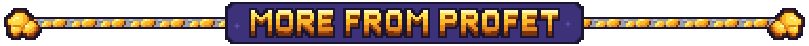

<!-- promo:start -->

<!-- promo:end -->

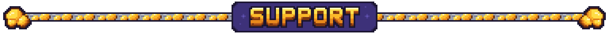

Veinminer is free. If it saves you some time, a coffee helps fund the next update.

Want your own server to play on with friends? My BisectHosting affiliate link gives you 25% off the first month, and I get a small commission.

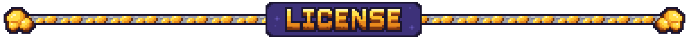

© 2026 Profet. All rights reserved.

- **You can** use Veinminer on any server, including monetized ones, include it in modpacks that credit Profet and link here, feature it in videos and modify it for your own world or server.
- **Please don't** re-upload it or a modified version, sell it, or present it as your own.

Full terms: [LICENSE](https://github.com/ProfetGit/veinminer/blob/main/LICENSE).

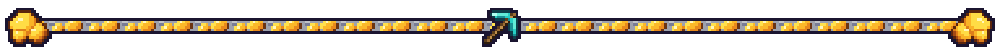
